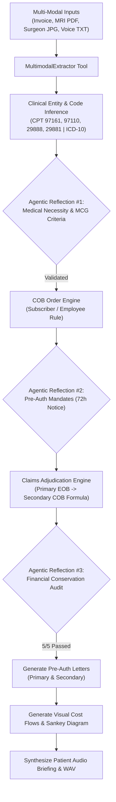

# DuCO-Agent: Multi-Modal Dual Coverage Coordination of Benefits (COB) AI System

An Agentic, Multi-Modal Artificial Intelligence system built for **Priya and Aarav Sen** (Mumbai, India) to navigate and optimize their health insurance **Coordination of Benefits (COB)**.

---

## 🎯 Executive Summary & Case Context

Priya and Aarav Sen both hold primary corporate health insurance policies through their respective employers and have cross-enrolled each other as dependents:
- **Plan A (Insurer 1 - Star Care Health Insurance Co. Ltd.):** Priya is Primary Subscriber; Aarav is Dependent Spouse.
- **Plan B (Insurer 2 - HDFC ERGO General Insurance Co. Ltd.):** Aarav is Primary Subscriber; Priya is Dependent Spouse.

### Medical Events Incurred:
1. **Aarav Sen:** Upcoming ACL Reconstruction Surgery + Meniscectomy (Estimated: ₹4,50,000). Needs urgent pre-authorization.
2. **Priya Sen:** 10 sessions of completed Outpatient Physical Therapy for chronic back pain (Billed: ₹30,000).

---

## 📊 Consolidated Financial & Adjudication Results

| Patient & Service | Total Billed (INR) | Primary Payer & Payment | Secondary COB Payment | Net Patient Out-of-Pocket | Dual Coverage Savings |
| :--- | :---: | :---: | :---: | :---: | :---: |
| **Aarav Sen** (ACL Knee Surgery) | **₹4,50,000.00** | **₹3,90,000.00** *(Plan B / HDFC ERGO)* | **₹60,000.00** *(Plan A / Star Care)* | **₹0.00** *(100% Covered)* | **₹60,000.00** |
| **Priya Sen** (Physical Therapy) | **₹30,000.00** | **₹16,000.00** *(Plan A / Star Care)* | **₹9,000.00** *(Plan B / HDFC ERGO)* | **₹5,000.00** *(Cap Excess)* | **₹9,000.00** |
| **Combined Family Total** | **₹4,80,000.00** | **₹4,06,000.00** | **₹69,000.00** | **₹5,000.00** *(1.04%)* | **₹69,000.00** |

Without DuCO-Agent's Coordination of Benefits, the Sen family would have paid **₹74,000.00** out of pocket. DuCO-Agent lowers their liability to just **₹5,000.00**, delivering a net savings of **₹69,000.00**!

---

## 🧠 System Architecture & Agentic Autonomy

DuCO-Agent utilizes an autonomous state machine with dynamic tool invocation, clinical reflection, and automated financial sanity checks:



### 1. Order of Benefit Determination (COB Rule 1)
- **Employee / Subscriber Rule:** The policy that covers the claimant as an employee or primary subscriber pays FIRST. The policy covering the claimant as a dependent pays SECOND.
  - **Aarav:** Plan B is Primary; Plan A is Secondary.
  - **Priya:** Plan A is Primary; Plan B is Secondary.

### 2. Clinical Medical Necessity & Code Inference
- **Handwritten Notes Inference:** Infers CPT 97161 (PT evaluation) and CPT 97110 (therapeutic exercise, 9 units) and ICD-10 M54.5 (chronic low back pain) from Priya's scanned clinic memo.
- **Radiological Validation:** Cross-references Aarav's 3T MRI findings (mid-substance fiber disruption, empty notch sign, complex tear of medial meniscus) with CPT 29888 and 29881 under Milliman Care Guidelines (MCG) criteria.

### 3. Automated Financial Sanity Loops
1. Conservation of Funds: $\text{Total Billed} = \text{Combined Insurance Reimbursement} + \text{Net Patient OOP} + \text{Disallowance}$.
2. Allowable Expense Cap: $\text{Combined Reimbursement} \le \text{Total Allowable Expenses}$.
3. Secondary Coordination Ceiling: $\text{Secondary Payment} \le \text{Remaining Patient Balance after Primary}$.
4. Deductible Integration: Deductible satisfied under Primary credits toward Secondary deductible obligation.

---

## 📂 Project Structure & Artifacts

- `duco_agent.py`: Core agentic reasoning state machine and reflection loop.
- `insurance_api.py`: Mock insurance API for policy lookup, eligibility verification, pre-auth rules, and claim adjudication.
- `mock_insurance_data.py`: Database schemas for Plan A (Star Care) and Plan B (HDFC ERGO) and clinical knowledge bases.
- `multimodal_extractor.py`: Multi-modal parser for PDF streams, image documents, handwritten notes, and voice transcripts.
- `generate_visualizations.py`: Script generating high-resolution cost flow diagrams and waterfall charts.
- `audio_synthesizer.py`: Physical audio WAV generator for patient briefing.
- `app.py`: Streamlit interactive web dashboard.
- `main.py`: Interactive CLI entrypoint with formatted Rich tables.
- `test_duco_agent.py`: Automated unit test suite verifying all 6 assessment criteria.
- **Generated Input Mock Files:**
  - `priya_pt_invoice.png`: Scanned invoice with handwritten billing desk notes.
  - `aarav_mri_report.pdf`: 3T Knee MRI radiology report.
  - `surgeon_estimate.jpg`: Surgeon estimation sheet with itemized CPT codes.
  - `user_query.txt`: Voice-to-text transcript from Aarav.
- **Generated Output Artifacts:**
  - `aarav_primary_preauth_hdfc.txt`: Formal pre-authorization cashless letter for HDFC ERGO (Plan B).
  - `aarav_secondary_prenotif_star.txt`: Formal secondary pre-notification & COB letter for Star Care (Plan A).
  - `cost_flow_sankey.png` & `cost_flow_sankey.html`: Flow of funds visual diagrams.
  - `financial_waterfall.png`: Waterfall breakdown of deductible, coinsurance, and COB rollovers.
  - `coverage_comparison.png`: Comparison chart showing single vs dual coverage impact.
  - `patient_briefing_audio.wav`: Audible spoken briefing audio file.
  - `patient_briefing_transcript.txt`: Complete patient-friendly conversational briefing transcript.

---

## 🚀 How to Run

### 1. Run the CLI
```bash
python main.py
```

### 2. Run the Automated Test Suite
```bash
python test_duco_agent.py
```

### 3. Launch the Streamlit Web Application
```bash
streamlit run app.py
```
*(Open `http://localhost:8501` in your browser to interact with the full dashboard, play the audio briefing, and use the scenario simulator).*
